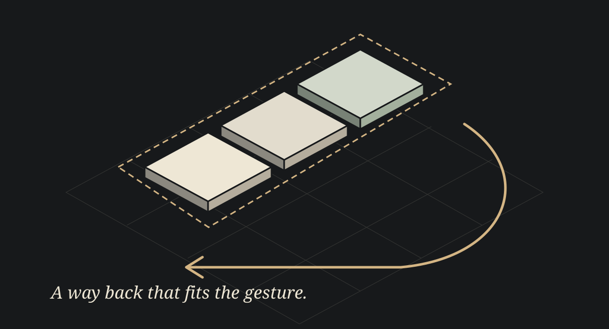
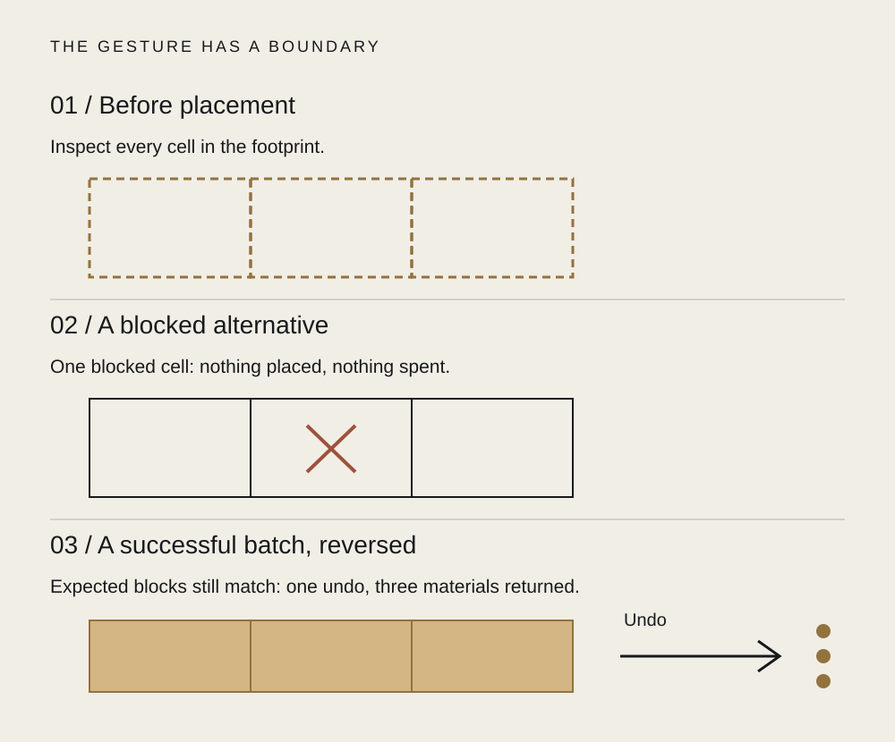

# 008 / A whole staircase. One undo.

**Archived field study draft — SkyStack Builder.** Source inspection of a Windows game proof of concept. The illustrations are authored explanations, not game screenshots. The reading edition is [Field Note 008](../../docs/notes/008-one-undo.html); this archived draft stays outside the catalog and sitemap.

*Several pieces. One intended gesture. Editorial illustration, not a capture of SkyStack.*

You meant to build a little way across the island.

Three pieces, perhaps. A run of ramps. Something the pony could try. You place it, look again, and change your mind.

How many times should you have to undo?

The machine can count the pieces. The player has a different unit: the thing they just tried.

That is the small design question inside SkyStack Builder’s stamp tools. This rough Windows prototype lets a player work with single blocks, a small platform, a line, or a three-cell run labelled “Stairs.” The run follows the selected shape and direction. It does not solve a whole staircase for you; the existing ground still matters.

The interesting part is where the gesture begins and ends.

## Before the click

A stamp needs a footprint you can inspect. Every proposed cell belongs to the preview. If one part would leave the island, meet an occupied cell, hit the height limit or cost more material than you have, the whole proposal must remain a proposal.

Without that boundary, a click can leave two placed pieces and one unexplained gap. The player has to discover what happened, count what was spent and repair a shape they never asked to build.

The source validates the complete footprint before spending or placement. It also includes rollback paths for spending and placement failures. That is the machinery behind a simple expectation: either this little thing fits, or it stays in your hand.

*Source-derived contract sketch. The blocked example is an alternative to successful placement, not a step that leads to it. Three cells illustrate the east-facing ramp run.*

## After the click

A successful multi-cell stamp goes into history as one batch. One undo attempts to remove that batch and refund its materials.

The source checks that every target still has the expected block at its top before removal. If those checks fail, it reports “Undo failed” and keeps the history entry. It does not promise that the world can always be wound backwards.

That limit matters. A reassuring label should not turn a changed world into somebody else’s cleanup job.

There are tradeoffs. A bounded stamp is quicker to preview and easier to understand than a freeform blueprint editor. It also offers fewer shapes. Grouping the gesture makes reversal coherent, but undoing one piece within the group remains a separate editing task.

## Something worth trying again

The hypothesis is that a player will explore more freely when the preview, material cost and reversal all describe the same gesture. We have not measured that with players here.

A useful next observation is small: ask someone to place a three-cell run, reject a blocked proposal and undo a successful one. Before they press Undo, ask what they expect to disappear. Watch whether the result matches the thing they believed they made.

The island can keep its weather, critters and pastel strangeness. Underneath it, the editor needs a dependable idea of “that thing I just did.”

A little room to try. A way back that fits the gesture.

## Source and limits

Reviewed source: `digablesolutions/sky-stack-builder` at `33f5c034227b81466a0e9e06bc442206e457d398`.

- [Stamp vocabulary and footprint](https://github.com/digablesolutions/sky-stack-builder/blob/33f5c034227b81466a0e9e06bc442206e457d398/src/app/build_stamps.h): single, 2×2 platform, three-cell line and three-cell run; selected shape/direction and bounds helpers.
- [Placement handler](https://github.com/digablesolutions/sky-stack-builder/blob/33f5c034227b81466a0e9e06bc442206e457d398/src/app/game_app_input.cpp): validation, spending rollback, placement rollback and one `BatchPlace` history entry.
- [Validation and undo](https://github.com/digablesolutions/sky-stack-builder/blob/33f5c034227b81466a0e9e06bc442206e457d398/src/app/game_app_state.cpp): occupancy/cost checks, expected top-block checks, batch removal and refunds.
- [Existing native tests](https://github.com/digablesolutions/sky-stack-builder/blob/33f5c034227b81466a0e9e06bc442206e457d398/tests/SkyStackBuilder.Tests/main.cpp): footprint, orientation, bounds and duplicate-cell cases. These were inspected, not executed for this editorial study.

No Windows build, native gameplay capture, player study or end-to-end undo verification was performed here. Source inspection supports the described implementation paths; it does not establish every rollback path or player outcome. The older stamp plan/index still lists unfinished work, so this study uses the pinned implementation rather than treating that planning status as delivery evidence.
