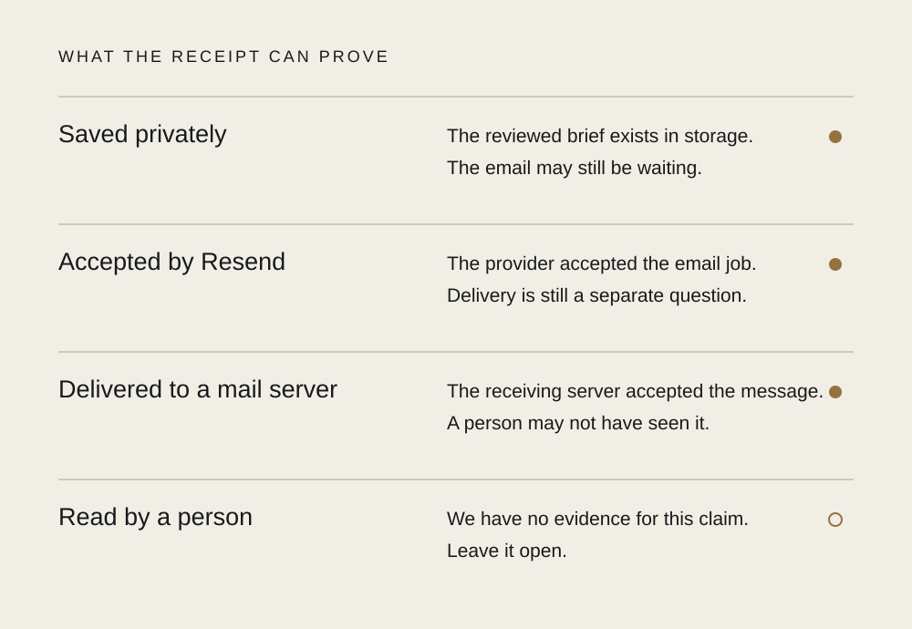

# 008 / A receipt should say what arrived

**Editorial draft.** Unpublished; not part of the archive, feed or sitemap. The implementation is prepared with live setup disabled. The observations below come from local contract and browser fixtures, not a live client engagement or production email rehearsal.

*Generated editorial metaphor. A paper can be held while its message is still travelling.*

You give a small form a difficult question. Perhaps you have spent longer finding the words than filling the boxes. Then you press Send.

The button has one job to do. Its answer has several.

“Sent” can mean the browser stopped waiting. It can mean a server kept the words. It can mean an email provider accepted a job. None of those tells you whether another person has seen the question.

That little word asks the visitor to carry quite a lot of uncertainty.

For Moth & Gravel’s private enquiry handoff, we are giving the receipt something smaller to stand on: **your question is saved privately.** The reviewed words and the job that carries them by email are saved together. If the email has trouble afterwards, the question still has a place to be found.

The first receipt belongs to the question. The email has its own evidence.

*Contract diagram, not a production screenshot or a guaranteed sequence. A later bounce can still change the delivery result. Human attention stays open.*

Resend’s delivery event describes acceptance by the receiving mail server. That is useful evidence. It does not give us someone’s attention. We can say where the message got to without supplying an imaginary person at the other end.

The stranger case is silence. A connection drops after the server has kept the question but before the browser gets its receipt. From the visitor’s side, nothing happened. From the studio’s side, the question may already exist.

A new attempt with a new reference would turn that doubt into two questions. So the browser keeps the reviewed words and their reference before the first attempt. A retry checks for that receipt and carries the same question again if needed. It does not quietly rebuild the brief from whatever the visitor has since edited.

Our browser fixture deliberately loses the first response after its simulated endpoint keeps the words. Reloading the tab and retrying recovers the receipt without a second submission. Separate service tests reopen the database and find the original snapshot with one delivery job. Those checks cover this bounded handoff; they do not establish real mail delivery or the resilience of a host we have not configured yet.

There is a limit to the promise, too. Resend keeps its email deduplication keys for 24 hours. Our worker stops uncertain automatic retries before that window runs out. After that, someone must inspect the evidence. “Try again” should not become a machine that makes extra mail forever.

And a receipt cannot promise a project. It says nothing about availability, price or whether the question has a useful answer yet. Those belong to a conversation.

There is room for warmth in a form without borrowing certainty. A question can find a place to rest before anyone knows what to do with it.

## Evidence and publication gate

- Studio implementation: `services/enquiries/store.mjs`, `worker.mjs`, `server.mjs`; browser `docs/assets/enquiry.mjs`. Explicit operator replies and a receiving route are prepared; the public example workbench is still fictional.
- Local fixtures: `services/enquiries/test/handoff.test.mjs` and `scripts/audit_enquiry.mjs`. No live emails, fabricated client outcomes or production measurements.
- Primary provider contract: [mail-server delivery](https://resend.com/docs/webhooks/emails/delivered), [24-hour idempotency keys](https://resend.com/docs/dashboard/emails/idempotency-keys), [raw webhook verification](https://resend.com/docs/webhooks/verify-webhooks-requests).
- Before publication: review the voice and illustrations, confirm final CI evidence, decide whether to publish as a bounded design study now or add a controlled host/mail rehearsal later. Keep the distinction explicit either way. Choose a genuine publication stamp only when adding it to the catalog; no date belongs on the reading surface.
