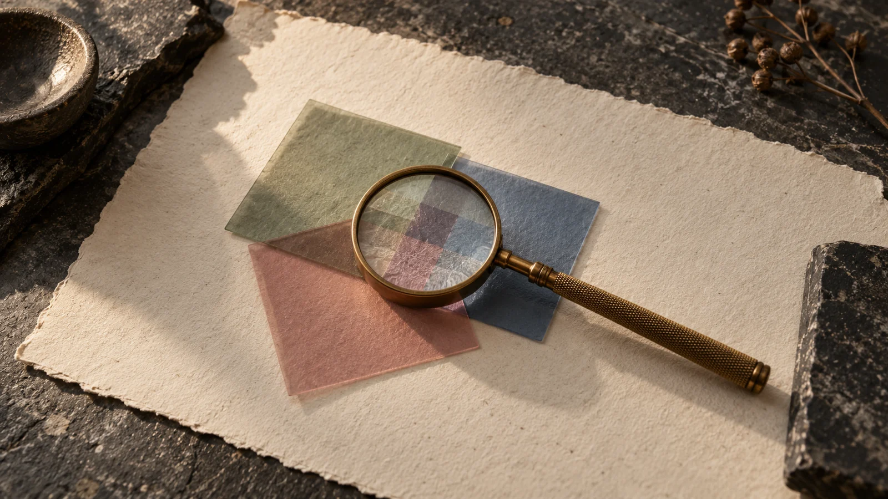
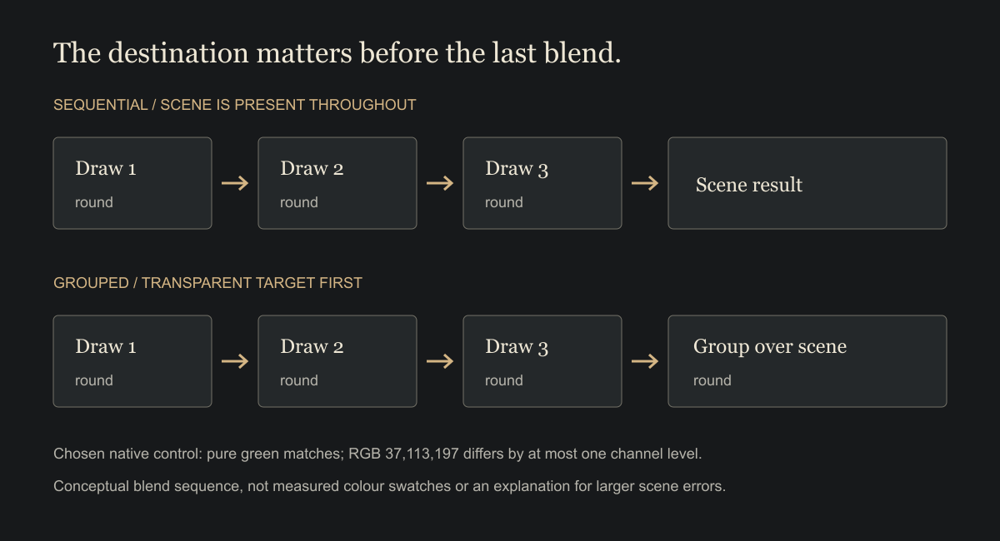

# 010 / Almost the same.

**Field study draft — SkyStack Builder.** Notes on small differences and knowing where to look. Outside the published archive, feed and sitemap.

*Looking closely at a small disagreement. AI-generated editorial illustration, not measured colour swatches.*

Lay three translucent sheets over a colour. Gather them together first, then lay the group down. You might expect the same picture.

In SkyStack Builder's rendering experiments, that small change can leave a small difference. The order of the work stays familiar. The place where it happens changes.

How closely should two pictures agree before we call them the same?

## A difference needs a place to look

The experimental renderer gathers some painted content into a transparent layer before placing it over the scene. Each draw rounds its colour into the available range. The final composition adds another place where that can happen.

A simple test sets the island aside and draws three overlapping translucent rectangles. On a green background, the two approaches match exactly. On another background, thousands of pixels differ by a single level in a colour channel.

The background matters. A tidy answer from one convenient example can leave another question untouched.

*Two ways to assemble a picture. A conceptual diagram of drawing and rounding, not a measured pixel image.*

## Small is a description, not a verdict

A one-level difference tells us something about the machinery. It leaves the design question open.

Does the difference appear along an edge? Does it flicker as the camera moves? Does it change the separation between a character and the ground? A count alone cannot say how the picture feels to someone trying to use it.

The wider scene comparisons also contain much larger differences. The small rounding example gives us a useful explanation for one kind of disagreement. The rest still needs attention.

## Look at the whole island

A close inspection and a whole view serve different purposes. One helps find a cause. The other lets us ask whether the place still holds together.

Remove a troublesome detail and a comparison may become easier to understand. Put it back before judging the island. The edge, shadow or patch of ground may be exactly what gives the player a sense of where something belongs.

The next study would show the complete views at the size and pace of play. Let someone turn the camera and choose a block. Ask what caught their eye, what seemed to change and whether that change made a choice harder.

Keep the close comparison beside those observations. It gives a specific disagreement somewhere to live, without asking it to decide the whole experience.

## Leave room for another look

There is pleasure in getting two pictures to agree. There is useful work in understanding why they don't.

A pixel can give the investigation a starting point. The person looking at the island gives it a reason to continue.

## Study scope / A small comparison

This study reads native rendering controls and recorded scene comparisons. The rectangle example found an exact match on one background and a one-level channel difference on another. Those conditions and the detailed results remain in the editorial provenance record.

The illustrations explain the question; they are not rendering captures. No new benchmark or player study was run for this note. The comparison does not establish that a small colour difference is always harmless, or that the complete renderer is ready. The proposed observation remains to be done.

Related draft: [A place to stand.](009-pony-visibility.md).
