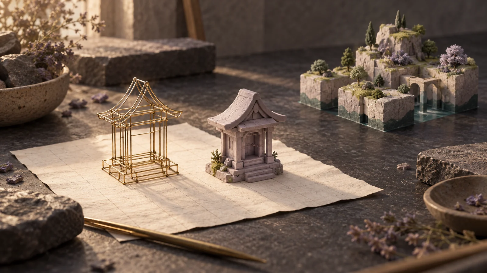
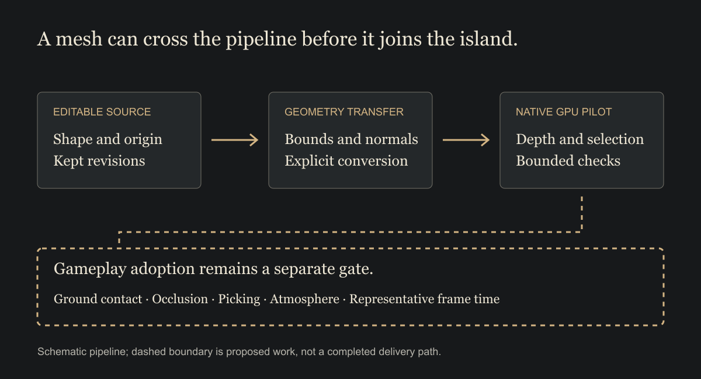

# 011 / Bringing a Blender model into a playable island

**Field study draft — SkyStack Builder.** A mesh pipeline and the adoption work beyond it. This draft is outside the published archive, feed and sitemap.

*A model on the workbench, an island beyond it. AI-generated editorial illustration, not the actual shrine mesh, a Blender render or evidence of gameplay adoption.*

A small shrine is an encouraging thing to see on a workbench. It has a shape, a palette and a place for its base. Turn it around and it still looks like the same object.

Getting that object into a game asks another set of questions. Where does it meet the ground? What hides it? Can a player select the thing they can actually see? What happens when several copies share the island with weather, characters and buildings?

The modelling tool can help answer the first set of questions without settling the second.

## Give the asset a recoverable route

SkyStack's Blender lane keeps editable source and exported geometry. The collectible-shrine verification record reports 292 triangles, a zero origin, preserved round-trip bounds, finite nondegenerate normals and opaque materials.

Those checks describe an asset contract. They help catch a model that changes size in transit, acquires an unexpected offset or carries invalid surface data. They do not tell us whether the shrine sits correctly among the game's other objects.

The generation script also refuses to overwrite an existing revision. That is a small but useful boundary: a new experiment should not silently replace the material someone may need to return to.

## Test a mesh as a mesh

The separate Direct3D pilot loads converted GLB geometry into vertex and index buffers. It uses a depth buffer and an object-ID target for selection. A screenshot of Blender is not standing in for the object.

The pilot's interaction contract is familiar: orbit, zoom, recenter and select. Its documented click-and-drag boundary distinguishes a small click from an orbit gesture; losing capture or focus clears the gesture. These details matter when a model stops being something to admire and becomes something to use.

The pilot also requires a hardware device rather than quietly substituting software rendering. Its bounded smoke mode writes correctness receipts. The documentation explicitly distinguishes those from frame-time measurements.

## A successful crossing is not the whole journey

*Schematic pipeline. The dashed boundary is proposed adoption work, not a completed delivery path or a claim that the shrine is a default pilot asset.*

The collectible shrine and the pilot's default mesh scene are distinct artifacts. A shrine verification record does not establish that it is one of the meshes currently selected by the default gameplay renderer.

Nor does a functioning standalone mesh window establish the complete island's performance. Immutable buffers may be a sensible rendering ingredient, but the final frame also includes terrain, actors, atmosphere, interface and the order in which they meet.

The next adoption step should name a specific asset and a specific gameplay use. Put it at an authoritative world anchor. Inspect it from both sides and from above. Select it beside an occluder. Measure a representative scene before and after the change. Keep the original asset masters and a way to compare the previous representation.

That makes the pilot useful without asking it to promise an island it has not yet built.

## Source and limits

- [Shrine verification](https://github.com/digablesolutions/sky-stack-builder/blob/d68bdc6e182548e62f9c093470be327b4bd6fb93/assets/blender/exports/collectible-shrine-v1/verification.json) records the asset checks above.
- [Revision-preserving Blender generator](https://github.com/digablesolutions/sky-stack-builder/blob/d68bdc6e182548e62f9c093470be327b4bd6fb93/scripts/blender/generate_collectible_shrine.py) defines the source/export route.
- [Native pilot documentation](https://github.com/digablesolutions/sky-stack-builder/blob/d68bdc6e182548e62f9c093470be327b4bd6fb93/tools/blender_gpu_pilot/README.md) describes its real-mesh path, controls, smoke mode and adoption boundary.

This note reads the pinned source and committed verification record. It does not report a new Blender render, a fresh pilot run or a measured gameplay speedup. The shrine's default gameplay adoption and complete renderer parity remain unestablished. No pilot or game screenshots are presented here.

Related draft: [Keeping a pony above the ground](009-pony-visibility.md).
