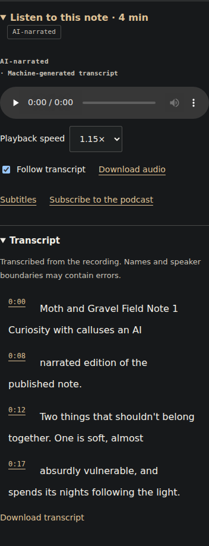
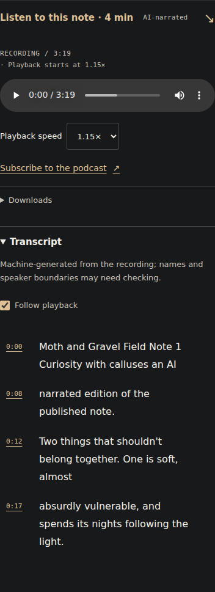
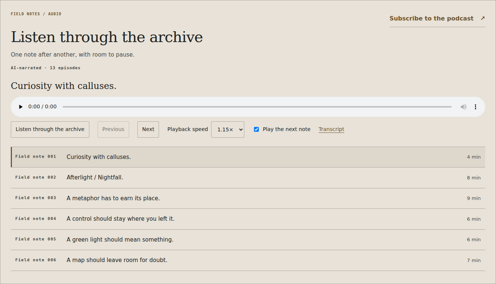
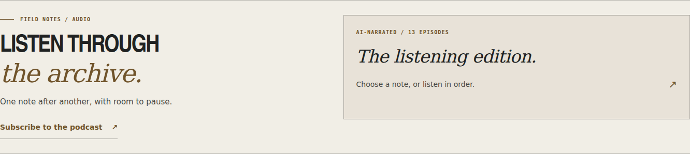
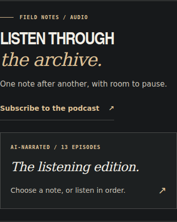

# Field Notes / the listening edition

The audio edition belongs beside the writing. Its first implementation used the
studio's colours, but gave the archive a large, permanently expanded control
panel. This sprint restores the reading hierarchy and treats listening as an
editorial edition, with ordinary controls carrying the work.

Reviewed against current main (`699e877`), including the finite moth scene, and
the real 13-episode collection.
The recordings, source fingerprints, subtitle timing and podcast identities are
unchanged. This is a design and browser review, not a human listening review.

## Critique and changes

| Finding | Change | Evidence |
| --- | --- | --- |
| The full player and 13-row queue displaced the featured writing. | A compact native disclosure opens the listening edition; a separate episode chooser keeps the list optional. | At 390 px, the initial audio section is 441 px tall instead of 952 px. Desktop is 298 px instead of 763 px. |
| The archive looked like a generic media panel despite using the correct palette. | Hairline rules, condensed headings with italic serif contrast, restrained specimen labels and the existing bone/charcoal/brass tokens. | Night and Afterlight reviewed at 320, 390 and 1440 px. |
| AI labels, playback options and downloads competed at equal weight. | One narration disclosure, a measured recording duration, grouped transport, a quiet download disclosure and a visible podcast route. | Native playback, default 1.15× rate and keyboard controls pass. |
| Timestamps interrupted the transcript's reading column. | A narrow timestamp column and a stable text column; playback following lives beside the transcript. | Article and archive seeking/highlighting pass without horizontal overflow. |
| Selecting audio removed the route to the corresponding writing. | Current edition, queue position, duration and written-note link update together. Conversation/comparison editions link to their recording. | The note-002 route and the comparison fallback are checked in the browser audit. |
| The archive offered a text-file link without a timed transcript. | Load the selected timed transcript when its disclosure is opened, cache it for this visit, and provide the correct readable download on failure. | Blocked requests, recovery and late responses after a different selection are exercised. |
| Closing the player could leave audio running out of sight. | Closing the listening disclosure pauses playback, retaining the current position in that player. | Closing, reopening, Play/Pause and stopping at the archive's end are checked. |

Native media controls retain their familiar browser appearance. The authored
frame, typography and hierarchy carry the studio identity; keyboard and
no-JavaScript playback remain usable. No waveform decoration, new font download,
animation dependency or account flow is introduced.

## Review captures

Before and after the article player, at 390 px in Night:

Before and after the archive's arrival state, at 1440 px in Afterlight:

The revised phone arrival state:

## First-paint budget

The reported CI failure was a 1,003.8 ms mobile median against the unchanged
1,000 ms budget. Homepage sections following the hero now use
`content-visibility: auto` and remembered intrinsic block sizes, so the opening
does not need to render distant editions and specimens. The scope is limited to
the homepage's hero siblings; the header and opening remain fully rendered.
Fragment navigation, keyboard access, both themes and no-JavaScript reading are
part of the landing audit. Rendered-copy checks scroll to deferred sections
before inspecting them; the assertions about the actual copy remain intact.

The local comparison used three cold loads per profile, the same host and
Lighthouse 13.5.0 with Playwright's Chromium 140 headless shell. The managed local
environment cannot launch full Chromium's process singleton; hosted CI keeps its
existing full Chromium runner. The final comparison uses the same latest-main
content in both copies, with offscreen rendering enabled only in the candidate.
Mobile median FCP changed from 1,031.3 ms to 970.3 ms, LCP from 1,202.7 ms to
1,202.5 ms; TBT and CLS were zero. Desktop FCP was 247.4 ms before and 267.9 ms
after, both within budget. All four Lighthouse categories scored
100 in this local comparison. These are lab observations, not a field-speed
promise; hosted CI must confirm its own result.

The approach follows [Google's rendering guidance](https://web.dev/articles/content-visibility)
and [the CSS property documentation](https://developer.mozilla.org/en-US/docs/Web/CSS/Reference/Properties/content-visibility).

## Validation

- 91 offline Python tests, Ruff, generated-site and integrity checks.
- 11 Node model checks.
- Actual-media browser audit: 320/390/1440 px, both themes, native playback,
  pause, caption seeking, queue advance/end, selected writing, transcript failure
  and stale-response handling, no JavaScript and zero axe violations.
- A synthetic-media version of the same audit remains in CI. The local audit
  server now serves image/JavaScript MIME types and MP3 byte ranges correctly;
  synthetic MP3s use the production encoding: mono, 24 kHz and 96 kbit/s.
- The wider landing audit covers responsive headings, specimen interaction,
  first-engagement scope, fragment navigation, themes and no-JavaScript access.
- The integrated moth and material-handling audits pass with the new rendering
  rules, including motion preference changes, pause/replay and static fallbacks.

Real narration and machine recognition still require listening review for names,
negations, qualifications and voice identity. Publishing the collection does not
turn that pending review into a verification claim.
