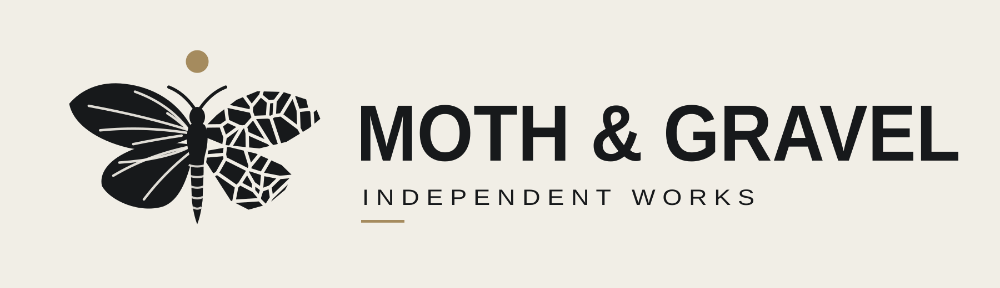

<picture>
  <source media="(prefers-color-scheme: dark)" srcset="https://raw.githubusercontent.com/mothandgravel/.github/main/profile/assets/wordmark-dark.svg">
  <source media="(prefers-color-scheme: light)" srcset="https://raw.githubusercontent.com/mothandgravel/.github/main/profile/assets/wordmark-light.svg">
  
</picture>

### Drawn to light. Built for rough ground.

**An independent software and design studio in Finland.**

Behind Moth & Gravel is [slideep](https://mothandgravel.com/#studio), with 25+ years of systems experience. The studio builds interfaces and the software behind them, from cloud services and mobile apps to connected hardware.

### A first piece of work

One stubborn question, one artifact you can inspect and keep, then a decision about what to do next. Typically 1–2 weeks at a fixed fee. We agree on the scope and deliverable in writing before work starts.

[See how a first piece of work runs](https://mothandgravel.com/#first-piece-of-work)

### Specimens

- [Sohva Remote](https://mothandgravel.com/specimens/sohva/) is an interface study of how a phone remote shows what the TV last reported.
- [Ajo maintenance bench](https://mothandgravel.com/specimens/maintenance-acceptance/) records a real file change with a deliberately interrupted reply and shows the evidence available before trying again.
- [Coastal watch](https://mothandgravel.com/specimens/coastal-watch/) uses synthetic tracks on a real coastline to show what a chart can tell you after position updates stop.

[Browse all specimens](https://mothandgravel.com/specimens/) · [Try a fictional shared workbench](https://mothandgravel.com/workbench/)

### Field Notes

Notes from the workbench on interface behavior, systems under load, and the evidence behind design decisions. [Read the archive](https://mothandgravel.com/notes/) or [listen to the audio editions](https://mothandgravel.com/notes/#listen-archive).

[Written notes RSS](https://mothandgravel.com/notes/feed.xml) · [Podcast feed](https://mothandgravel.com/notes/podcast.xml)

### Get in touch

[Email hello@mothandgravel.com](mailto:hello@mothandgravel.com) or [draft a brief](https://mothandgravel.com/questions/) you can keep or send. If you have a GitHub account, you can also [open a public issue](https://github.com/mothandgravel/.github/issues/new?template=signal.yml). Use email for private details.

[Website source](https://github.com/mothandgravel/.github/tree/main/docs) · [Brand marks and materials](https://github.com/mothandgravel/.github/tree/main/profile/assets)
