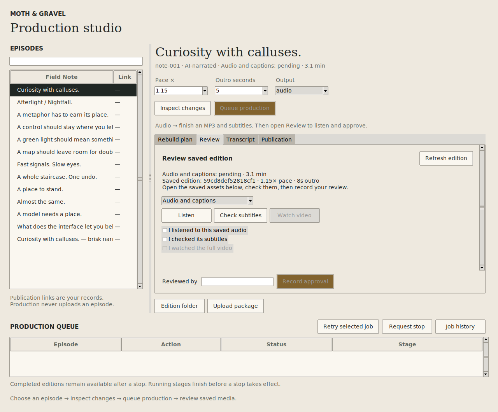

# Moth & Gravel production studio



A Tkinter/ttk workspace for the existing local production engine. Choose a prepared
episode, inspect the consequences of pace/outro changes, queue an edition, listen
and check subtitles, then prepare the upload package. Record URLs and publication
dates for episodes you have already published separately from their production jobs.

## Get an episode out

Open **Release** for the guided handoff:

1. **Review full video** opens the saved-edition review with the correct scope.
2. **Inspect package** selects export and shows the plan. Use **Queue production**
   to create the package after checking it.
3. **YouTube Studio** opens the upload destination in your system browser. Open
   **Upload package**, choose its video/thumbnail/subtitles, and copy the title,
   description and tags from **Release → Upload details**.
4. In **Publication record**, record the published link and its actual date.

Episode links and dates now fill from the existing podcast catalog. This is data
from the checkout, not a live check of YouTube or another platform. Dates preserve
the catalog timestamp's timezone. Saved user records always take precedence,
including intentionally blank dates/links; automatic defaults do not write records.
**Use podcast details** restores those defaults explicitly. Changing a link clears
an untouched suggested date, so a podcast date is not silently assigned to YouTube.
An explicitly edited date is preserved. **Today** fills the local system date only
when clicked. Save remains an explicit action.

Upload copy reuses the same publishing settings and copy generator as export,
including shared/per-episode tags, hashtags, disclosures, the written-edition link
and music credit. With a local edition, credit comes from its verified saved recipe;
without one, the copy is labelled a draft using configured credit. Refreshing copy
does not replace unfinished publication edits. If an upload package exists, copy comes
from its checksummed title/description/tags/hashtags files. Export again to apply new
settings; then refresh the copy. Export retains its existing shared-settings behavior,
including for already-running workers.

No account connection is needed for this workflow. The browser handoff opens
YouTube Studio; file selection and publication happen there. Studio never infers
that an upload package or a saved URL means a platform publication was verified.
The UI research and adaptation choices are in [publishing-ux.md](publishing-ux.md).

## Run in Ubuntu / WSL

The first version runs **inside the existing Linux/WSL production checkout**.
The engine uses Linux process locks. On Windows 11, use WSLg to show the window;
native Windows packaging and a Windows-to-WSL transport are future work.

```bash
sudo apt-get update
sudo apt-get install -y python3-tk ffmpeg xdg-utils
python3 -m field_notes_studio
```

The checkout must already contain prepared episodes and their original media.
There are no additional pip dependencies for the studio. Video/thumbnail rendering
uses the existing Node 22+ / Remotion toolchain:

```bash
npm ci --prefix video
```

The studio launches the worker itself; no terminal production command is needed.
The selected episode shows its verified saved-edition status. Output guidance explains
the next step for audio, preview, full video or export.

Use **Inspect changes**, then **Queue production**. Editing a control invalidates the
inspected plan. `audio` finishes an MP3 and retimed captions; `preview` also renders
the first ten seconds of video; `video` produces the full video and thumbnail;
`export` packages the selected completed full edition. Export ignores pace/outro
controls and refuses a changed edition pointer. Export does not upload anything.
Pace and outro controls are disabled while export is selected.

The queue shows running, waiting and failed/interrupted job counts. Select a row to
see its captured recipe, latest stage or error, and the next useful action:

- **Listen to saved audio**, **Watch preview** or **Watch saved video** opens that
  job's exact saved output, even when a newer edition has since been produced.
- **Open upload package** opens the selected export job's folder.
- **Review latest** selects the job's episode and opens Review with audio
  or full-video scope. It clears a shelf filter if needed. Review always verifies
  the latest saved edition, which may be newer than the selected job.
- **Request stop** is available for queued/running jobs until a stop is requested.
  **Retry** is available for failed, interrupted or stopped jobs when that
  episode has no active job. **History** retains the detailed stage journal.

Previews can be watched from the queue; they cannot be approved as full videos.

**Listen** and **Check subtitles** open the latest local edition in system applications.
**Watch video** opens the saved full video. Playback is external in this version;
there is no embedded player, seek bar or timeline.
The transcript tab shows the published transcript. Production always uses the preserved
source narration, including when the feed already contains finished audio. New editions
retain pending human review state. In the **Review** tab:

1. Choose **Audio and captions**, or **Full video and audio** for a YouTube edition.
2. Open the saved assets with **Listen**, **Check subtitles** and **Watch video**.
3. Check the corresponding confirmations, enter your name, then **Record approval**.
4. For a full edition, choose **export**, inspect changes and queue the upload package.

Review is attached to the exact verified media, independently of your draft pace/outro
controls. Approval revalidates hashes and source identity under the production lock;
changed editions and changed media are rejected. Switching episode or scope, refreshing
or producing another edition clears the confirmations. A preview cannot be approved as
a full video. The studio refreshes after job state changes without hashing media on
every queue poll. Use **Refresh edition** after production or review in another terminal.

The equivalent terminal command remains available:

```bash
python3 -m field_notes_audio review note-001 --audio-only --approve --reviewer "Your name"
# For a completed full video, omit --audio-only and check the video too.
```

## What survives closing the window

- The independent worker continues processing the queue; it is not a Tk thread.
- Recipes, source identities, results, stage events and publication records live in
  `artifacts/studio/studio.sqlite3`. Media remains in `artifacts/production`.
- Each job captures its recipe. Later edits cannot change that job. A changed source
  blocks it; retry keeps the original recipe and source identity.
- The shelf restores the last queued pace/outro for each episode. Unqueued edits are
  drafts and are not saved. Other settings come from the production config.
- A worker restart takes its exclusive OS lock before marking previously running jobs
  **interrupted**. This means an unknown outcome, never assumed success. Reopen the
  studio to restart a crashed worker, inspect outputs and retry explicitly.
- Retry creates a new job. The engine validates and reuses completed caches; it does
  not promise resumption within an interrupted FFmpeg/render operation.
- Stop is cooperative: a running stage finishes its transactional writes before the
  next boundary stops the job. Its row shows **stop requested** while waiting.

One worker serializes media jobs. Distinct episodes queue behind each other; duplicate
active jobs for an episode are rejected across windows. The queue allows 32 pending
jobs. The UI polls durable snapshots once per second; stage events are structured,
not parsed from terminal text. Fine-grained encoder progress is not available yet.

Inspect the journal without a display, or drain pending work explicitly:

```bash
python3 -m field_notes_studio jobs
python3 -m field_notes_studio worker --once
```

The worker is a checkout-scoped local process, not a system service. It stays idle
after the GUI closes to accept later jobs. Repeated launches are fenced by its OS lock.
Its diagnostic log is `artifacts/studio/worker.log`.

## Separation of concerns

| Module | Responsibility |
|---|---|
| `models.py` | Episode/job values and states |
| `presentation/` | Shelf, workspace, queue, release/review forms, shared scrolling and theme; no workers or files |
| `controller.py` | UI intent, stale-plan protection and main-thread mailbox |
| `service.py` | Application use cases; no widgets or production internals |
| `repository.py` | Atomic SQLite jobs, events and publication records |
| `processes.py` | Detached worker launch and system file opening |
| `pipeline.py` | Existing engine adaptation and rebuild explanations |
| `worker.py` | Exclusive queue ownership, execution and reconciliation |
| `app.py` | Composition and Tk event-loop lifecycle |

The engine gains an optional structured stage observer. Existing CLI output and cache
identities are unchanged. The adapter requests one audio worker so callbacks stay in
the owning context. Views receive background results through a main-thread mailbox;
workers never receive widget references. Boundary tests enforce dependency direction.

Ideas borrowed from Kitronik Buggy: themed sections, asynchronous loading states,
bounded preview queues and the explorer's worker-to-queue-to-Tk pattern. Its combined
dashboard, camera/voice algorithms and Windows MCI playback are not copied. The first
studio has no frame stream; use a bounded latest-frame queue when adding previews.

## Validation and the first Field Note

```bash
python3 tools/check_audio.py
xvfb-run -a python3 -m unittest discover -s tests/studio -t . -v
```

CI covers real Tk editing, plan invalidation, queueing, reopening and publication
records, main-thread delivery, cross-window conflicts, uncertain recovery, cooperative
stopping and real FFmpeg cache reuse with retimed captions. No Cloud credentials.

The experiment is **one published episode, one inspectable rebuild decision, one
recovery question**: change an outro, produce it, close/reopen while the worker runs,
inspect its outcome and listen to the result. Keep the Field Note provisional until
a human has tried that workflow in their WSL setup.
